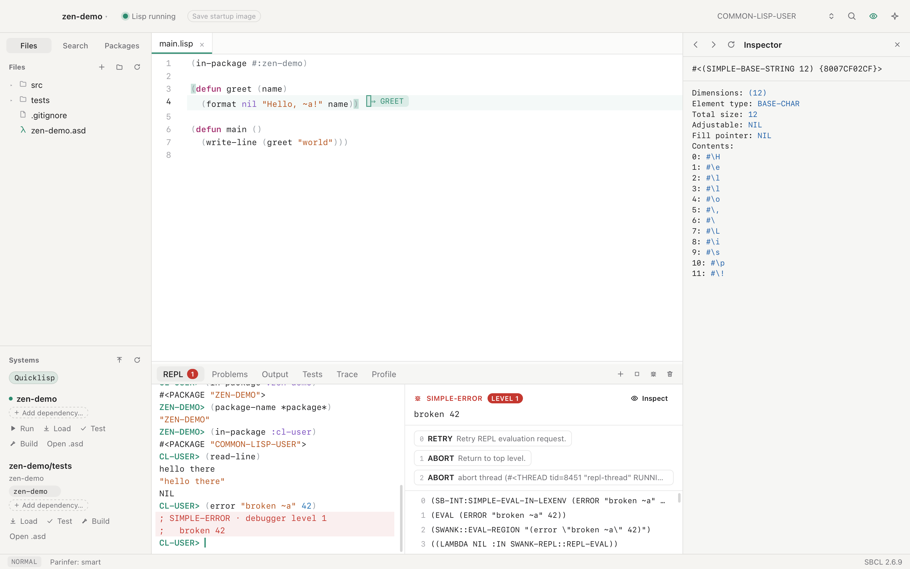
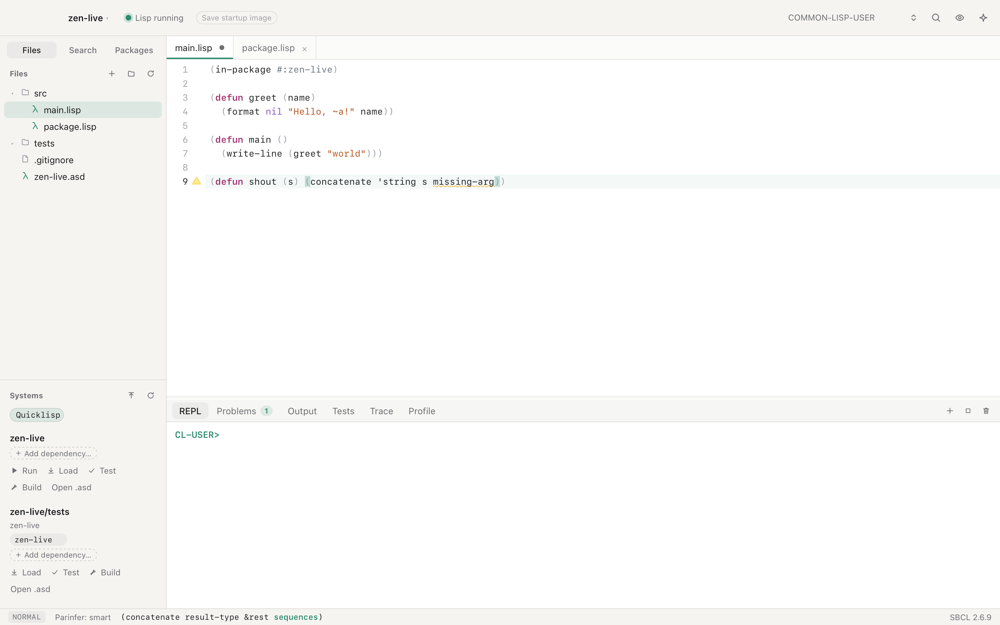
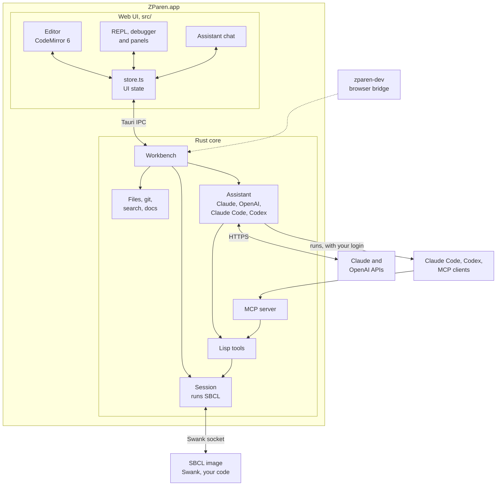

# ZParen

ZParen is a Common Lisp IDE for macOS, built on SBCL. You work in one live
image: evaluate a form, click the result to inspect the real object, stop in
the debugger, fix the code, and restart the frame that failed.
Claude and Codex can work in the same image, from the built-in assistant or
over MCP.

  
  
  
  
  
  
  

## Goal

I am very interested in Common Lisp. But I found it hard to set up Emacs or Vim
so that they are easy to use for Lisp. After an upgrade, I often had to find
the cause of strange errors, and that was frustrating.

So I decided to make an IDE that works the way I like:

1. Vim keys come first.
2. Emacs keys that make Lisp easy to edit.
3. An AI assistant from the first day.
4. MCP, so that external AI tools can work with ZParen.
5. Helpful tools.
6. Quicklisp, ocicl and qlot to manage packages.

Three decisions follow from that goal:

- **It works without setup.** The app includes SBCL and Swank. When you open
  a project folder, Lisp starts.
- **AI runs code in your Lisp, not in a copy.** Each project has one SBCL
  process. Your REPL, the built-in assistant and Claude Code over MCP all
  send code to it. If Claude Code defines a function, you can call it in the
  REPL at once, and the assistant can use the systems you loaded.
- **Projects are plain ASDF systems.** Dependencies come from Quicklisp,
  ocicl, qlot or a vendor folder. ZParen adds no files of its own, so the
  project builds the same way without ZParen.

## What it does

| Area | What you get | Read more |
| --- | --- | --- |
| Run and debug | A REPL of live objects, an inspector, a debugger that says what went wrong in plain words, with restarts and Restart Frame, breakpoints, stepping, trace, profile, tests and macroexpansion | [Run and debug](docs/run-and-debug.md) |
| Edit | Vim keys that take a Lisp symbol such as `rect-shape` as one word, SLIME's Emacs sequences, parinfer, structural editing, rename across the project, checking as you type, go to definition, a right-click menu in the editor and the REPL that asks the assistant about the selection, split panes and a git gutter | [Edit code](docs/editing.md) |
| Projects | ASDF systems with Quicklisp, ocicl, qlot or vendored dependencies, a dependency editor, builds and startup images | [Projects](docs/projects.md) |
| Coalton | Coalton projects, `.ct` and `.coal` files, types on hover, and type errors on the expression Coalton blames | [Coalton](docs/coalton.md) |
| Learn | A course from your first form to a query compiler, after *ANSI Common Lisp* and *On Lisp*: 28 lessons with a file and FiveAM tests each, four projects from lesson 16 on (a spreadsheet, an inventory to debug, a test framework, a query engine), and a git branch per lesson that records your progress | [Learn Lisp](docs/learn.md) |
| Panels | The Learn panel, the assistant, Documentation and the Inspector share the right side, with a tab for each view you opened, so you can go back to one as you left it | [Run and debug](docs/run-and-debug.md#repl-and-inspector) |
| AI | An assistant that works in your image and answers with Claude or Codex, through an API key or your own Claude Code or Codex login, and an MCP server for Claude Code | [Assistant and MCP](docs/assistant.md) |
| Extend | Plugins written in Common Lisp, and themes as JSON files | [Plugins](docs/plugins.md) |

## Install

Download `ZParen_<version>_aarch64.dmg` from the
[latest release](https://github.com/eric-zhu-2019/zparen/releases/latest),
open it, and drag ZParen to Applications. It needs a Mac with Apple silicon
and macOS 13 or later. Releases are signed with a Developer ID and notarized
by Apple, and they carry their own SBCL, so you do not need to install one.

ZParen checks for a newer release when it starts, and from ZParen ▸ Check
for Updates…. It installs the update and restarts when you agree. Releases up
to 0.1.8 cannot do this, so download the next disk image once by hand.

[Getting started](docs/getting-started.md) covers the first start and the
keys to learn first. To build from the source, see
[Develop and release](docs/development.md).

## Architecture

The UI never talks to Lisp directly. It sends typed requests to the Workbench
in Rust and renders the events that come back. The TypeScript types for both
are generated from the Rust ones into `src/protocol`.

The Workbench owns one SBCL process and talks to it over Swank, the protocol
SLIME uses. ZParen's own Lisp code in `resources/lisp` loads into that image
beside Swank, and so do your project and your plugins.

The assistant and outside agents reach the image through the same tools, so
what they evaluate is what you see in the REPL. In development, `zparen-dev`
serves the same Workbench over a WebSocket. That lets the UI run in a browser,
where the end-to-end tests drive it.

[How ZParen is built](docs/architecture.md) explains why it is designed this
way: why Swank, why a cached core, and how one request type serves every
caller.

Where the code lives:

| Path | What it holds |
| --- | --- |
| `src/` | The UI: React components in `ui/`, the CodeMirror editor in `editor/`, and a Lisp reader for the editor in `lisp/` |
| `src/protocol/` | TypeScript types generated from the Rust requests, responses and events |
| `crates/zparen-core/` | The Workbench: the SBCL session and Swank client, projects, files, git, search, docs, the assistant and the MCP server |
| `src-tauri/` | The Mac app: the window, menus, updates, and the IPC bridge to the Workbench |
| `crates/zparen-dev/` | The Workbench over a WebSocket, for the browser and the end-to-end tests |
| `crates/parinfer-wasm/` | parinfer-rust's engine, built to WebAssembly |
| `resources/lisp/` | ZParen's Lisp side: tools, breakpoints, tests, plugins, and the script that builds the cached core |
| `resources/swank/` | Swank, vendored from SLIME 2.30 |
| `e2e/` | Playwright tests that drive the real UI in WebKit |

## Tech stack

| Layer | Technology | Why this one |
| --- | --- | --- |
| App shell | [Tauri 2](https://tauri.app) | It uses the WebKit that macOS already has, so the app ships no browser engine, and its backend is Rust |
| Backend | Rust (edition 2024), tokio, axum, reqwest with rustls | Rust owns the processes, sockets and files, and one async runtime serves the UI, the MCP server and the assistant |
| UI | React 19, TypeScript, zustand, Vite | One store holds the UI state, and the types it exchanges with Rust are generated, not written twice |
| Editor | CodeMirror 6, `@replit/codemirror-vim` | A full Vim emulation, and an editor that takes Lisp-aware extensions |
| Parentheses | parinfer-rust in WebAssembly | The engine other editors use, run inside each edit so that one undo reverts both |
| Lisp | SBCL, Swank from SLIME 2.30, ASDF | Swank already has completion, the debugger, the inspector and cross-references |
| Packages | Quicklisp, ocicl, qlot | Each project keeps the manager it already uses |
| Search | ripgrep's crates (`ignore`, `grep-searcher`) | The same `.gitignore` rules as `rg` |
| AI | Anthropic Messages API, OpenAI Responses API, the `claude` and `codex` commands, MCP over Streamable HTTP (`rmcp`) | Replies stream over HTTPS or from the agent's JSON output, and the assistant and MCP share one tool table |
| Tests | Rust tests against a real SBCL, Vitest, Playwright on WebKit | Each layer is tested where it runs, and the UI in the engine the app uses |
| Release | GitHub Actions, Developer ID signing, Apple notarization | A version tag builds, signs, notarizes and publishes the disk image |

Without tests and generated code, ZParen is about 12,200 lines of TypeScript,
6,900 lines of Rust and 2,100 lines of Common Lisp.

## Documentation

| Document | For |
| --- | --- |
| [Getting started](docs/getting-started.md) | Installing, the first start, and the first keys to learn |
| [Run and debug](docs/run-and-debug.md) | The REPL, inspector, debugger, tools, tests and documentation |
| [Edit code](docs/editing.md) | Keys, Vim and Emacs bindings, structural editing, checking as you type, search and files |
| [Projects](docs/projects.md) | Opening and creating projects, dependency managers, systems and startup images |
| [Coalton](docs/coalton.md) | Coalton projects and files, types, the manual, and type errors |
| [Learn Lisp](docs/learn.md) | The course: lessons, exercises, checks, and progress in git |
| [Assistant and MCP](docs/assistant.md) | Claude, OpenAI, Claude Code and Codex in the app, and Claude Code over MCP |
| [Plugins](docs/plugins.md) | Extending ZParen in Common Lisp |
| [How ZParen is built](docs/architecture.md) | The design and the reasons behind it |
| [Develop and release](docs/development.md) | Building from the source, the checks, and shipping a release |
| [Built with Claude Code](docs/built-with-claude-code.md) | How Claude Code built ZParen, and the skills and agents it used |

## How it was built

I built ZParen from scratch with Claude Code, and chose Rust and Tauri for the
app after some experiments. Some people may ask why I did not write all of it
in Lisp. In my opinion, it is better to use the right tool for each job.
[Built with Claude Code](docs/built-with-claude-code.md) tells the story.

## License

ZParen is MIT licensed. See [LICENSE](LICENSE). It includes Swank from
[SLIME](https://github.com/slime/slime) in `resources/swank`, which is in the
public domain, and the parinfer engine from
[parinfer-rust](https://github.com/eraserhd/parinfer-rust) in
`crates/parinfer-wasm`, which is ISC licensed.
