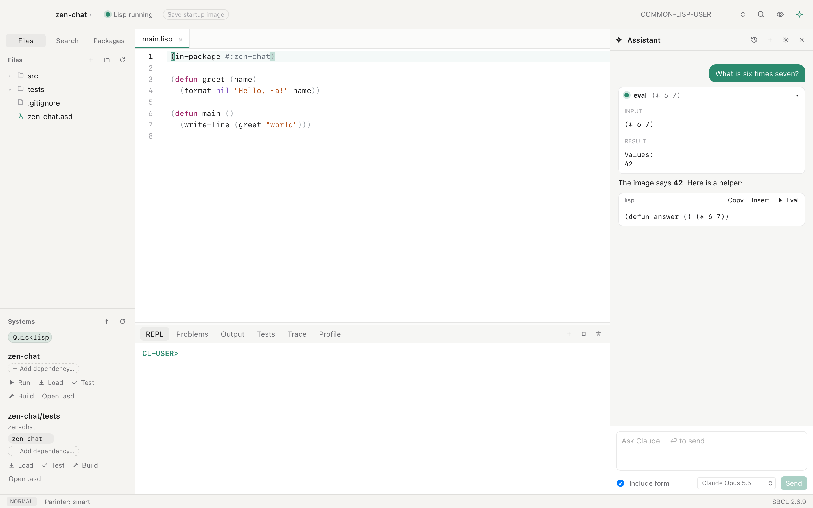
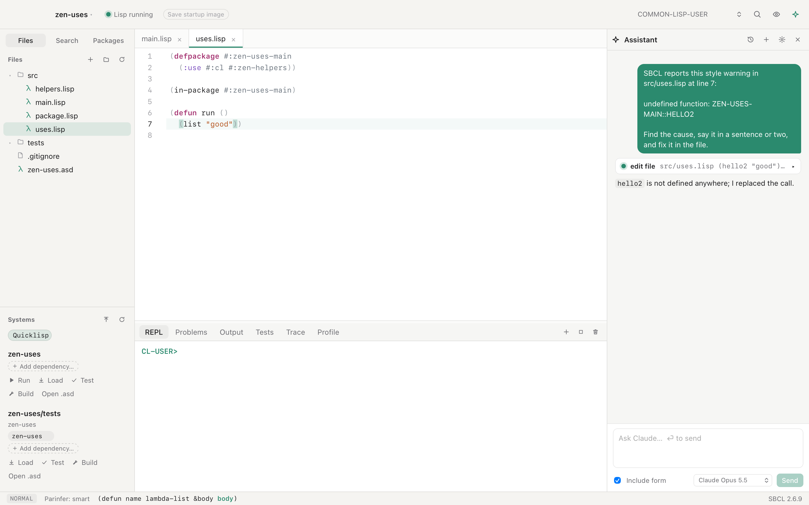

# Assistant and MCP

## The assistant

Open the assistant with ⌘L. It answers with one of four providers:

| Provider | How it signs in | Who pays |
| --- | --- | --- |
| Claude | An Anthropic API key | Your API account, per token |
| OpenAI | An OpenAI API key | Your API account, per token |
| Claude Code | The login of the `claude` command on your Mac | Your Claude plan |
| Codex | The login of the `codex` command on your Mac | Your ChatGPT plan |

The model menu under the chat switches between them, even mid-conversation.
Settings ▸ Assistant sets the model for each provider. The defaults are
`claude-opus-5-5` and `gpt-6.1-sol`, and you can type any other model name.
For Claude Code and Codex, **Default model** uses the model that the command
itself is set to. **Stop** ends a reply and any Lisp code the assistant was
running for it.

Claude and OpenAI need an API key, which you can paste in the assistant. For
Claude, ZParen also uses `ANTHROPIC_API_KEY`, `ANTHROPIC_AUTH_TOKEN`, or an
`ant auth login` profile. For OpenAI, it uses `OPENAI_API_KEY`. Set
`OPENAI_BASE_URL` to use another server that offers the Responses API.

Every provider uses the same tools as the MCP server below. Code proposed in a
reply has **Insert** and **Eval** buttons.

### Claude Code and Codex

ZParen can answer with the Claude Code or Codex that you already use in a
terminal, so the assistant runs on your subscription instead of an API key.

1. Install the command and log in once in a terminal: run `claude` for Claude
   Code, or `codex login` for Codex.
2. In the assistant's model menu, choose a model under **Claude Code** or
   **Codex**.

ZParen finds the command on your `PATH`, in Homebrew's folders, or in
`~/.local/bin`. If the command is missing or logged out, the assistant says
what to run, and **Check Again** looks once more.

For each reply, ZParen runs the command in the project folder and connects it
to its own MCP server. The agent gets only ZParen's tools, not its own file
and shell tools. Codex's shell is still there, but it is limited to reading
files. Your other MCP servers are not loaded for these replies. The agent
keeps its own conversation, and the next message continues it. If another
provider answered in between, ZParen sends the agent what was said, so you
can switch providers in the middle of a conversation.

Stop ends the command and the Lisp work its tool calls started. A tool call
that reaches ZParen after Stop does not run.



## Claude Code over MCP

To let Claude Code work in your image, register ZParen's MCP server once:

1. Open the assistant with ⌘L.
2. Click the gear icon at the top of the assistant panel.
3. Under **Use Claude Code with this image**, click **Copy command**.
4. Paste the command in a terminal and run it.

The command looks like this, with your token in place of `<token>`:

```sh
claude mcp add --transport http zparen http://127.0.0.1:7337/mcp --header "Authorization: Bearer <token>"
```

The token is a password that ZParen makes the first time its MCP server
starts. The server listens only on `127.0.0.1` and refuses any request
without the token, so other programs on your Mac cannot run code in your
image. The token stays the same each time ZParen starts, so you register only once.
It lives in `~/Library/Application Support/ZParen/mcp-token`, which only your
user can read. If you remove that file, ZParen makes a new token, and you
must register again. Keep the token out of chats and repositories.

The tools are `eval`, `compile_form`, `describe_symbol`, `apropos`,
`find_definitions`, `who_calls`, `macroexpand`, `list_packages`,
`project_info`, `load_system`, `run_tests`, `debugger_state`,
`invoke_restart`, `read_file`, `edit_file`, and `list_files`.

## Ask AI to fix

Every warning and error mark has an **Ask AI to fix** button. It shows in the
hover box and in the box that opens when the cursor reaches a mark. It sends
SBCL's message, the file, the line and the code to the assistant. The assistant
finds the cause and changes the file with `edit_file`. The
change shows in the editor at once, and one undo takes it back.


