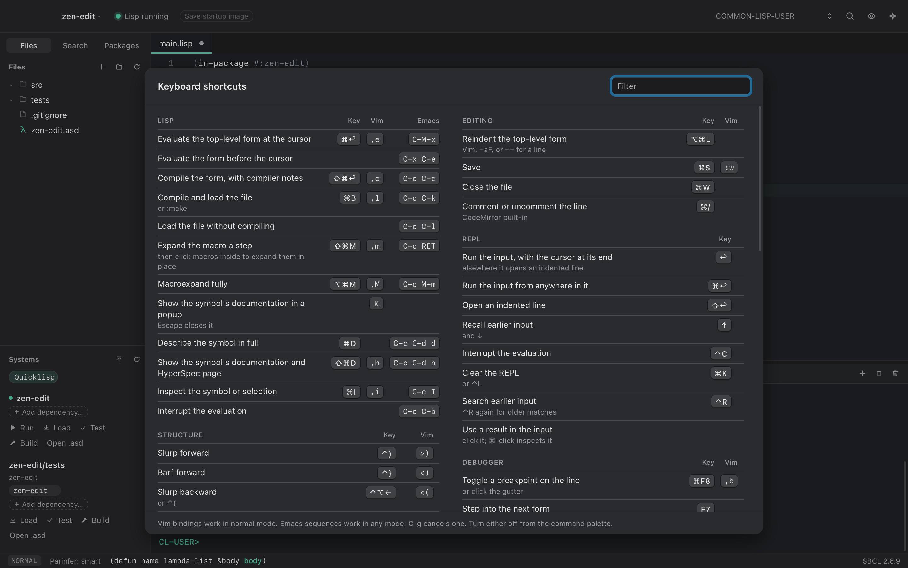
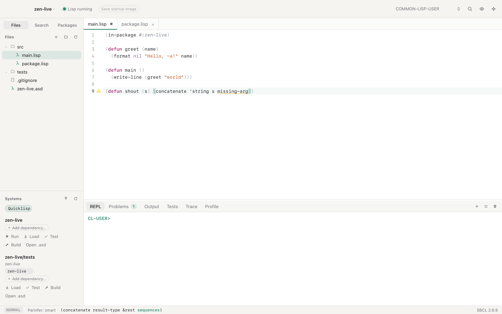
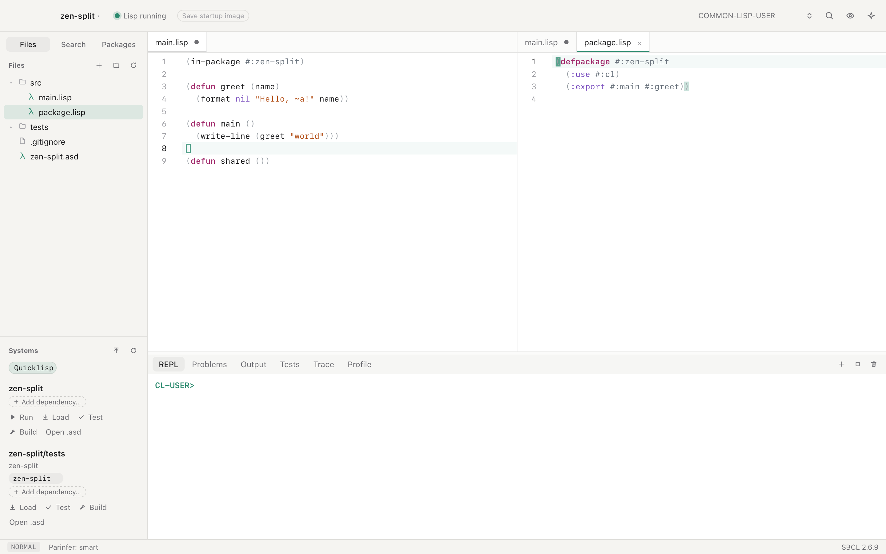
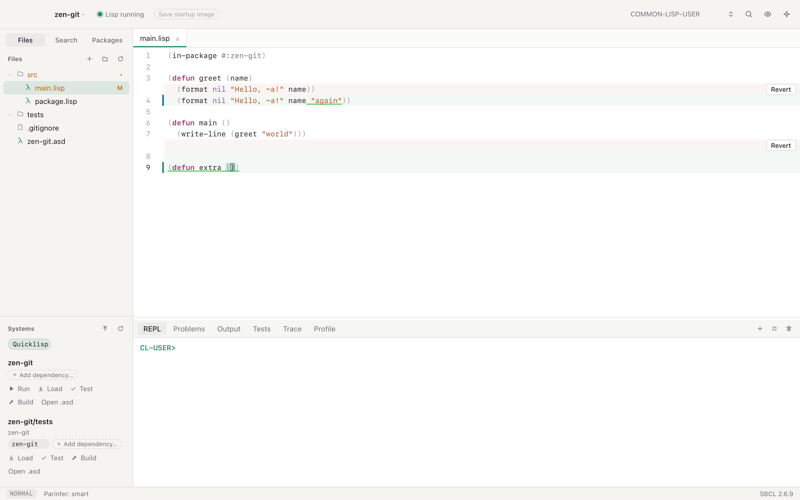

# Edit code

## Keys

Press ⇧⌘/ for every shortcut, with a filter. The list comes from the same
table that defines the bindings, so it is always current.

These are the ones you use most:

| Action | Shortcut | Vim |
| --- | --- | --- |
| Evaluate the form at the cursor | ⌘↩ | `,e` |
| Compile the form, with compiler notes | ⇧⌘↩ | `,c` |
| Compile and load the file | ⌘B | `,l` |
| Go to definition, find references | F12, ⇧F12 | `gd`, `gr` |
| Go back, go forward | ⌃O, ⌃⇧O | same in Vim |
| Slurp, barf | ⌃), ⌃} | `>)`, `<)` |
| Select a form | ⌃⇧⌘→ | `vaf` |
| Change the symbol at the cursor | | `cie` |
| Rename a symbol | F2 | `,r` |
| Search in project | ⇧⌘F | |
| Command palette | ⇧⌘P | |

SLIME's Emacs sequences work too, in any Vim mode:

| Sequence | Action |
| --- | --- |
| `C-x C-e` | Evaluate the form before the cursor |
| `C-M-x` | Evaluate the top-level form |
| `C-c C-c` | Compile the top-level form |
| `C-c C-k` | Compile and load the file |
| `M-.`, `M-,` | Go to a definition, and back |
| `C-c C-z` | Switch to the REPL |

The status bar shows a prefix such as `C-c` while you type it, and `C-g`
cancels it. Plugin commands list their keys in the same ⇧⌘/ screen.

Turn off Vim keys, Emacs sequences, parinfer or checking as you type in
Settings (⌘,).

## Structure

Parinfer keeps parentheses balanced as you type, and typing `(` or `"` over
a selection wraps it. The structural commands move code by whole forms:
slurp, barf, raise, splice, kill, transpose, split, and join.

Parinfer moves the closing parentheses at the end of a line when you change
the indentation. To see which ones it moves, turn on Settings ▸ Parentheses ▸
"Dim the closing parentheses parinfer moves". They keep their color, faded.
The line with the cursor is not dimmed. Nothing is dimmed when parinfer
refuses the text, for example because of a lone `"` in a comment, since it
then moves nothing. The status bar says why.

Indent guides are thin vertical lines in the indentation. Each form that
spans lines gets one, under its open parenthesis, on the lines below. A
guide shows only in the spaces, so text is never crossed. The guide of the
innermost form around the cursor takes its parenthesis color. To hide them,
turn off Settings ▸ Parentheses ▸ "Show indent guides under open
parentheses".

In Vim, these text objects work after an operator such as `d`, `c` or `y`,
and in Visual mode:

| Keys | Selects | Example |
| --- | --- | --- |
| `ie` | The symbol, string or list at the cursor, hyphens included | `cie` renames `skip-down-all` |
| `ae` | The same, with the space next to it | `dae` deletes an argument and its space |
| `if` | Everything inside the enclosing list's parentheses | `cif` rewrites the whole call |
| `af` | The enclosing list, with its parentheses | `daf` deletes the call |
| `iF`, `aF` | The same for the top-level form | `yaF` copies the whole `defun` |

Pressing `ie`, `af` or `if` again in Visual mode grows the selection to the
next list out.

## Rename

F2, or `,r` in Vim, renames the symbol at the cursor. A box opens on the
symbol with its name selected. Type the new name and press Return, or press
Escape to cancel. A local variable or local function is renamed in its form.
Any other symbol is renamed across the project, after a preview.

### A local variable or function

ZParen renames the binding and every use of it, and one undo takes the whole
rename back.

It reads the code as text, the way `gd` does, so it works before the code is
loaded. It knows which binding each use means. An inner `let` that binds the
same name keeps its own uses, and `'x`, `:x` and `"x"` stay as they are.

ZParen refuses, and says why, when a rename could change what the code
does:

- The new name is already used in the form, so a binding could capture it.
- The symbol is a plain `&key` parameter. Its name is also the keyword
  callers pass.
- The symbol is a slot name in `with-slots`.
- The name is both a local function and a variable in the same form.

When Lisp is running, ZParen also asks it to check the rename before making
it. Lisp expands every macro in the form, before and after the rename, and
compares the two. They must be the same code except for the new name. This
catches what reading the text cannot see, such as a macro of your own that
quotes the name or binds it. When the two differ, the box says so, and
Return again renames anyway. When Lisp cannot check, for example because it
is not running, ZParen renames and says the rename was not checked.

### A global symbol

A function, macro, variable or class is renamed in every file of the
project. Lisp must be running and have loaded the code that defines it.

1. Lisp says which symbol the name at the cursor is, such as `APP::GREET`.
2. ZParen refuses when the symbol is defined outside the project, such as a
   function from a library, or when the new name already means something in
   that package.
3. ZParen finds every token with that name in the project, and Lisp reads
   each one as the reader would. A token in another package, a keyword, a
   string or a comment does not count. Names in `defpackage`, such as
   `(:export #:greet)`, do.
4. The Search sidebar lists every place by file. Places Lisp confirmed are
   ticked. Places it could not read, such as code in a package that is not
   loaded, are unticked, and you can tick them.
5. **Rename** writes the files. An open file shows the change, and one undo
   in it takes the change back.

Files with unsaved changes must be saved first. A file changed since the
preview stops the rename before anything is written.

Lisp still has the old name defined until the code is compiled again. Load
the system again so that it uses only the new name.

## Checking as you type

Each file is compiled in the background, without loading it, and warnings
mark the exact symbol. Saving compiles only the top-level forms that changed
into the running Lisp. A loaded file changed by git or another editor is
compiled the same way.

Files are still checked while a load or compile is stopped in the debugger.
Choosing a restart checks the open files again, since the load may go on.

Each line with an error or warning ends with its message, in light text of
the mark's color: red for errors, yellow for warnings. SBCL's notes keep
only their mark. A line with several problems shows the most severe one and
"+N" for the rest. Click the message to open the full box,
with **Copy** and **Ask AI to fix**. Moving the cursor or typing closes it.
To have a box open whenever the cursor reaches a mark instead, as ZParen did
before, set Settings ▸ General ▸ Problems to **In a box at the cursor**.

The **Problems** panel lists compiler notes from every file. Every warning
and error mark has an **Ask AI to fix** button, described in
[Assistant and MCP](assistant.md#ask-ai-to-fix).

## Navigation and completion

`gd` goes to local bindings first, then to Lisp's own record of a definition,
then to definitions in code not loaded yet. ⌃O goes back.

Completion offers package and system names where code names them, such as
`(:use #:alexan`. ⌃N and ⌃P move through the list. `K` shows a symbol's
documentation in a popup.

## Files and search

The file tree creates, renames, and moves files to the Trash. When another
program changes an open file, ZParen reloads it if you have no unsaved
edits, and asks otherwise. It also asks before closing a file or quitting
with unsaved changes. Files outside the project are read-only and show a lock.
SBCL's own sources, which go to definition can open, are an example.

**Search** in the sidebar finds and replaces across the project, with the
same `.gitignore` rules as ripgrep. The trash button in the bottom panel
clears whichever tab is showing.

## The editor

- Split panes, side by side.
- A git gutter with inline diffs, and a Revert button on each change.
- Code colors that match everywhere. The editor, the REPL, the assistant's
  code blocks, the Learn panel and Markdown previews read code with the same
  reader, so strings, comments, `|symbols|` and nested `#| |#` comments look
  the same in each. Parentheses get a color for each depth.
- Heads of forms colored by what the running Lisp knows. Your own macros
  look like `when` and `with-open-file`, and a function named like syntax,
  such as `do-sum`, looks like a call. Settings ▸ Colors turns this off. A
  theme can set `syn-macro` and `syn-function` to give them their own colors.
- In the REPL, only your input and Lisp's results are read as Lisp. A
  program's output stays plain, so a quote it prints cannot change the colors
  that follow.
- Word wrap (⌥Z) and Markdown preview (⇧⌘V).
- A choice of editor and interface fonts.
- Solarized, Nord and Gruvbox themes, picked separately for light and dark.
  Your own themes are JSON files in the themes folder, which Settings opens.

