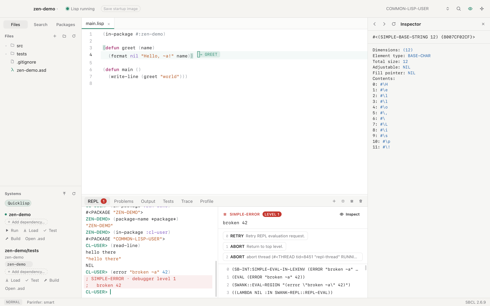
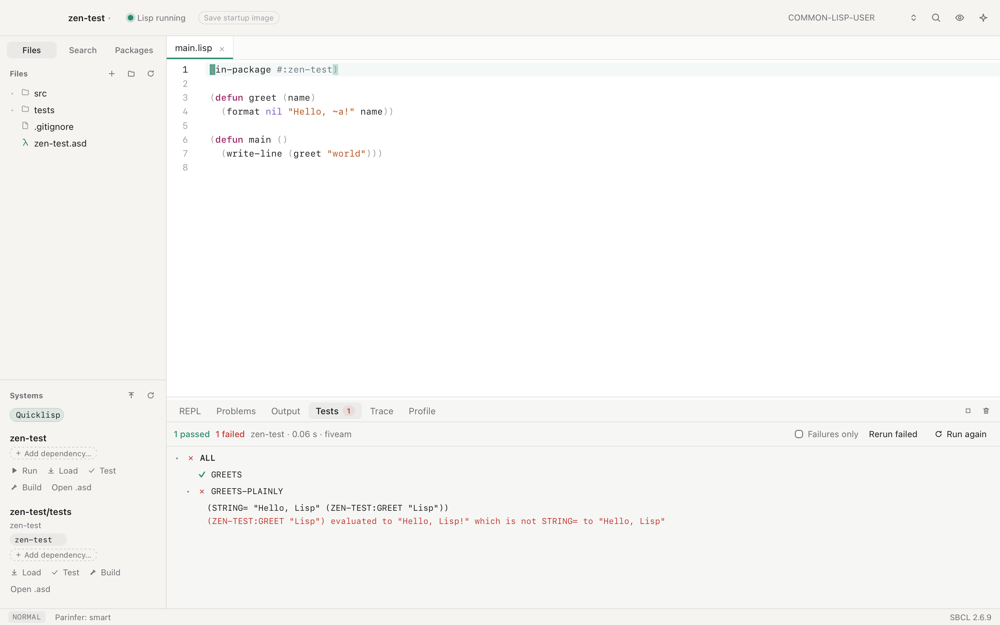
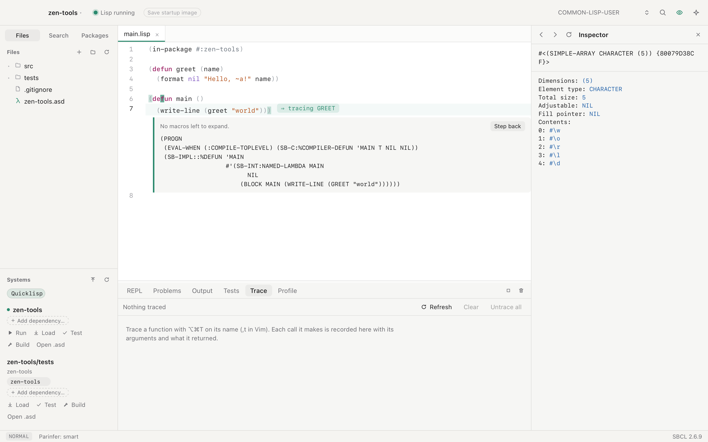

# Run and debug

ZParen keeps one SBCL running for the project. Everything on this page works
in that live image, so a fix you make while the debugger is open applies to
the call that failed.

## REPL and inspector

Results are live objects. Click one to use it in the next input, or ⌘-click
it to inspect it. ⌃R searches earlier input. Extra REPLs run in their own
threads. ⌘J goes to the REPL, and from the REPL back to the editor.

The REPL starts in `COMMON-LISP-USER`. To change its package, use the
package box in the title bar, or evaluate `(in-package …)` in the REPL. To make
the REPL follow the file you edit, turn on **Settings ▸ General ▸ REPL
package**. Each time you switch to a file, the REPL then switches to the
file's `in-package`, when Lisp has that package. A package you choose in the
REPL holds until your next file switch.

A right-click in the REPL opens a menu for what you clicked:

- Every item: **Explain** and **Ask Assistant About It…**, as in the editor,
  then **Clear REPL**.
- An earlier input: **Copy to Input**.
- A result: **Use in Input** and **Inspect Result**.
- A selection: **Evaluate Selection**, **Inspect Value**, **Copy**, and
  **Cut** in the input.
- A symbol in an input or a result: **Go to Definition**, **Find
  References**, **Show Documentation**, **Inspect** and **Trace Function**.

The inspector opens on the right. When the right panel holds more than one
view, such as the inspector and Documentation, a tab row shows at its top.
Click a tab, or press ⌃Tab and ⌃⇧Tab, to go back to a view as you left it.

With Vim keys on, the REPL uses Vim too. Each prompt starts in insert mode,
so you type as before. Press Escape for normal mode. There, `k` and the other
motions move into the transcript, `y` copies from it, and edits change only
the input. Enter runs the input, or copies an earlier input down to the
prompt. ↑ and ↓ recall earlier inputs. ⌃C, ⌃R and ⌃L keep their REPL meaning
in every mode: interrupt, search history, clear. `K` shows a symbol's
documentation.

## Debugger

An error stops the code where it happened and opens the debugger beside the
REPL. Nothing is lost: you choose how to go on.

- **What went wrong** comes first, in plain words: "`gret` is not defined as
  a function", "Expected a number, but got the string `"5"`", "Division by
  zero". For a name that is not defined, **Did you mean** lists names that
  are, and a click calls or uses that one instead. **Define** writes a stub
  after the form that calls the function.
- **The ways to go on** are buttons. **Abort** (q) gives up. Others retry, or
  go on with a value you type in the panel. Swank's own restarts wait under
  **More**.
- **The backtrace** shows your own frames, with file and line. SBCL's and
  Swank's frames fold, and a click opens them. Your innermost frame opens
  first, and the editor marks its form with each argument's value beside it.
- **Fix and go on:** change the function and compile it, or define it again
  at the REPL. The debugger then says which frame runs the old code, and
  **Restart frame** runs the new code from that call.
- **Evaluate in this frame** runs a form with the frame's values. An error in
  the form shows as text there, not as another debugger.
- An error while the debugger is open opens another level. The panel says
  so, and **Back to the earlier error** leaves it. The buttons offer only this
  level's ways to go on. Close returns every level to the top, however
  many errors deep you are.
- **Explain** asks the assistant what went wrong and how to fix it. **?**
  explains restarts, frames and levels, with a link to the course lesson
  when a course is open.
- **Show everything** shows SBCL's own text: the whole condition, every
  restart and every frame. ZParen remembers the choice.

Form breakpoints and stepping stop the code where you choose.

### Breakpoints

Click the gutter left of a line to set a breakpoint on the form that starts
there. Click it again to clear it. A solid dot means the breakpoint is on
compiled code. A hollow dot means the code is not loaded yet, or the form
makes no call to stop at.

Code stops at a breakpoint wherever it is called from in the project's Lisp:
the REPL, **Run** in the Systems list, or the tests (⌘U). A load or a test
run that loads a file again puts its breakpoints back on the new code before
that code runs. The debugger opens in the REPL tab with the form and the
backtrace. **Into** (F7), **Over** (F8) and **Out** (⇧F8) step from there,
and **Continue** (F9) runs on. A time limit around the code, such as the 5
seconds the Lisp course gives each check, does not end the stop.

To see values, look beside the code in the editor, or at the frame in the
backtrace: its arguments and locals show there. Click a value to inspect it.
Type a form in **Evaluate in this frame** to run it with those variables,
for example `(length name)`. SBCL sometimes keeps a variable under a name the
compiler made, such as `#:G2` for an argument passed to `format`. These
compiler temporaries hide behind a link under the locals.

A breakpoint stops only the project's Lisp. A Learn Lisp **Check** runs in a
new SBCL, so it does not stop there.

## Tools

- **Trace** and **Profile** panels.
- **Macroexpansion** in place, under the form.
- **Disassembly** of a function.
- **Tests** for FiveAM, Parachute and Rove, shown as a tree.

## Documentation

The Docs panel (⇧⌘D) shows argument lists, docstrings, apropos and the
standard's page for each Common Lisp symbol. Release builds carry the
[Common Lisp Community Spec](https://cl-community-spec.github.io), made from
the draft ANSI standard. To see the HyperSpec instead, set
`ZPAREN_HYPERSPEC` to its folder. A build without the Community Spec uses a
HyperSpec from Quicklisp, or offers to install one. Hover a symbol to see its documentation, or its argument list when
it has none. In Vim, `K` shows a symbol's documentation in a popup.

## Sessions

A project's next session loads the systems its last one loaded. Assistant
conversations are kept, listed and continued.

To start Lisp with the project's systems already loaded, save a startup
image. See [Projects](projects.md#startup-images).
